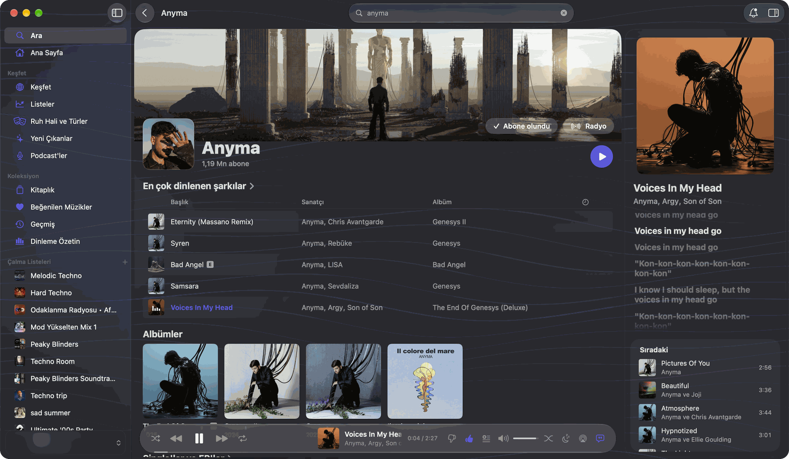
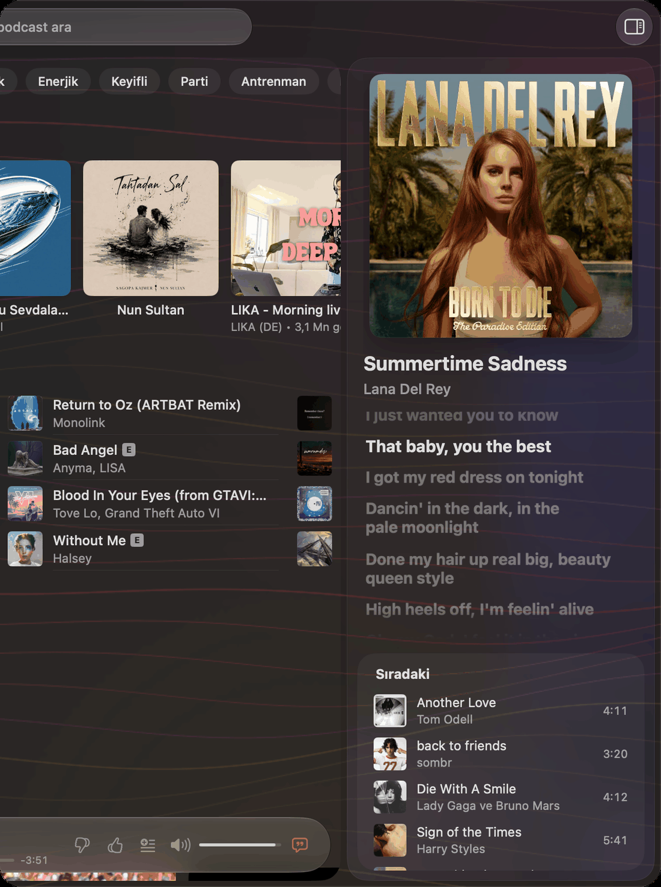
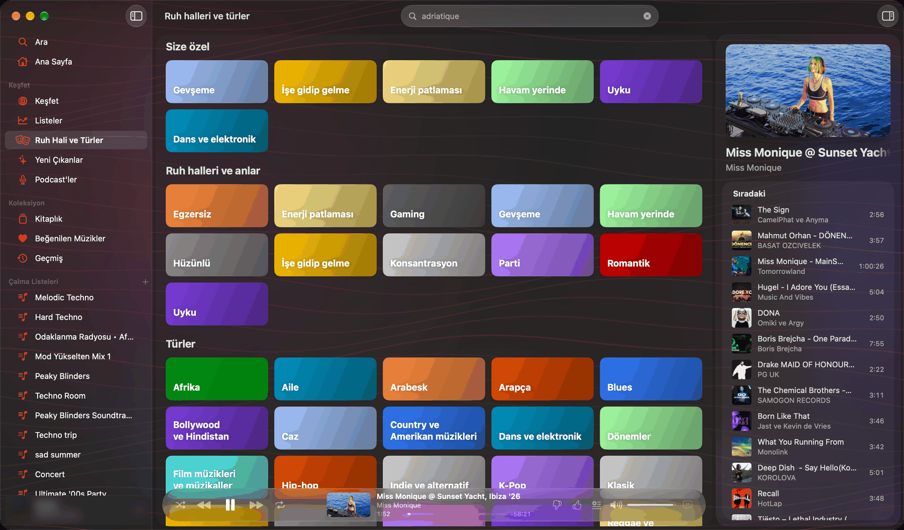

<p align="center">
  
</p>

<h1 align="center">YT Music for macOS</h1>

<p align="center">
  A native, lightweight YouTube Music client for the Mac — built with SwiftUI, in the spirit of Apple Music.
</p>

<p align="center">
  
  
  
  
</p>

<p align="center">
  <b>English</b> · <a href="README.tr.md">Türkçe</a>
</p>

<p align="center">
  
</p>

> **Unofficial.** This app is not affiliated with, endorsed by or sponsored by YouTube or Google. “YouTube” and “YouTube Music” are trademarks of Google LLC. You need your own YouTube Music account; YouTube Music Premium unlocks the highest audio quality.

---

## Why

The YouTube Music website is a heavy web app. This is a real Mac app instead: no browser engine plays your music, nothing runs in a hidden web page, and it sits quietly in the background.

- **Native all the way.** SwiftUI interface, `AVPlayer` for audio, `JavaScriptCore` only to read YouTube Music's data format. No Electron, no web player.
- **Full quality.** With Premium, songs play as **256 kbps AAC** — the best stream YouTube Music offers — untouched: no re-encoding, no resampling.
- **Light.** About **1.5 % CPU** and **~170 MB** of memory while playing in the background (measured on the author's MacBook).
- **At home on macOS.** Liquid Glass on macOS 26 and later, translucent sidebar, light and dark mode, your choice of accent colour.

## Screenshots

| | |
|---|---|
|  |  |
| **Playlists and albums** — play, shuffle, radio, edit your own playlists | **Artists** — popular songs, albums, singles, subscribe |
|  |  |
| **Time-synced lyrics** that follow the song; click a line to jump there | **Search** — top result, songs, albums, artists, playlists, videos |
|  |  |
| **Explore** — new releases, charts, moods and genres, podcasts | **Settings** — appearance, 12 accent colours, background |

<p align="center">
  
  <br><b>Light and dark mode</b> follow the system; the accent colour tints the whole app.
</p>

## Features

**Listening**
- Home with quick picks, mixes and category chips; Explore, New releases, Charts, Moods & genres and Podcasts.
- Album, playlist, artist, podcast and episode pages; your library, liked music and history.
- A real queue: “Up next”, radio and automix, shuffle and repeat. Songs you dislike are kept out of your queues.
- The last song (and where you stopped) is back in the player when you open the app.
- The next song's first 10 seconds are loaded ahead, so songs change without a gap.

**Your library**
- Create, rename, describe and delete playlists, and change their privacy.
- Add songs to playlists, remove and reorder them. The player shows when the playing song is already in one of your playlists.
- Like / dislike songs, subscribe to artists.

**Lyrics and Now Playing**
- Side panel with the cover, lyrics (time-synced when available, via YouTube Music and [LRCLIB](https://lrclib.net)) and the queue.
- Media keys, Control Center / menu bar Now Playing, Dock menu, keyboard shortcuts for everything.

**Design**
- Apple Music–style layout: translucent sidebar, floating glass player, side panel.
- A calm, still background pattern in your accent colour (“Flow”), or plain.
- Adapts to the screen: roomy on a large display, denser on a laptop so more fits without scrolling.
- Loading previews shaped like the page that is about to appear.
- Menus follow the system language (English or Turkish).

## Requirements

- macOS 14 Sonoma or later (Liquid Glass on macOS 26 and later)
- Apple's Command Line Tools (Xcode is not needed)
- A YouTube Music account (Premium for 256 kbps)

## Install

There is no signed download yet; you build the app yourself. It takes about a minute:

```bash
xcode-select --install          # once, if the Command Line Tools aren't installed

git clone https://github.com/demir1283/yt-music-macos.git
cd yt-music-macos
./build.sh --install            # builds "YT Music.app" and copies it to /Applications
```

`./build.sh` without `--install` builds the app in the project folder and opens it from there. Because the app is built on your own Mac, macOS doesn't show an “unidentified developer” warning.

On first launch, click **Sign in** in the sidebar and log in with Google.

## Keyboard shortcuts

| Shortcut | Action |
|---|---|
| Space | Play / pause |
| ⌥⌘→ / ⌥⌘← | Next / previous song |
| ⌘↑ / ⌘↓ | Volume up / down |
| ⌥⌘L | Like |
| ⌃⌘S / ⌃⌘R | Shuffle / repeat mode |
| ⌘F | Search |
| ⌘1 … ⌘4 | Home, Explore, Library, Liked music |
| ⌘[ | Back |
| ⌥⌘P | Show / hide the side panel |
| ⇧⌘L | Lyrics |
| ⌘, | Settings |

## Privacy and security

- **Your password never touches the app.** Sign-in happens on Google's own page (shown in a sheet). The app only keeps the resulting session cookies, in macOS's standard per-app cookie store on your Mac. **Sign out** in the account menu removes them.
- **No accounts, servers, analytics or tracking of its own.** The app talks only to YouTube / Google (music, your library) and LRCLIB (lyrics, sent the song title and artist).
- **Nothing is cached.** Covers, pages and lyrics are not written to disk; songs stream and keep about a minute buffered in memory. The one file the app keeps is the prepared stream decoder for the current YouTube player version (~1 MB, in `~/Library/Caches`).
- **No keys or tokens in this repository.** Everything the app needs from YouTube is read at runtime from your own session.

## How it works

```
Google sign-in (sheet) ─▶ session cookies ─▶ URLSession
                                               │
YouTube Music data API ◀── bridge.js in JavaScriptCore (pages, queues, lyrics)
                                               │
Stream address ──▶ yt-dlp-ejs in JavaScriptCore (solves YouTube's stream challenge)
                                               │
                         AVPlayer ──▶ macOS audio (256 kbps AAC with Premium)
```

```
Sources/Encore/
  App/       app entry, menus, Dock menu, navigation model
  Engine/    YTMusic (the engine), NativeCore (JavaScriptCore + HTTP), StreamResolver,
             SigSolver, AudioPlayer, NowPlayingBridge, SyncedLyrics, Models
  Support/   theme, density, images, view-state helper
  Views/     window, sidebar, player bar, side panel, pages, shelves, loading previews
Tools/bridge.js     readable source of the embedded bridge (Engine/BridgeScript.swift)
Resources/          app icon, yt-dlp-ejs
```

If you edit `Tools/bridge.js`, copy it into `Engine/BridgeScript.swift` as well.

## Troubleshooting

- **Pages stay empty:** use **Reconnect** in the View menu; if YouTube shows a consent page, open YouTube Music in the browser once (⇧⌘Y).
- **Diagnostics:** `defaults write local.encore.player diagnosticLog -bool true` writes `YT Music.log` next to the app; `defaults delete local.encore.player diagnosticLog` turns it off. Read the log before sharing it anywhere.

## Credits

- [yt-dlp-ejs](https://github.com/yt-dlp/ejs) (public domain), bundling [meriyah](https://github.com/meriyah/meriyah) (ISC) and [astring](https://github.com/davidbonnet/astring) (MIT) — solves YouTube's stream challenge.
- [LRCLIB](https://lrclib.net) — open, time-synced lyrics.
- Design inspired by Apple Music and the open-source [Kaset](https://github.com/sozercan/kaset).

## License

[MIT](LICENSE). The bundled yt-dlp-ejs keeps its own licence (`Resources/ejs/LICENSE`).
