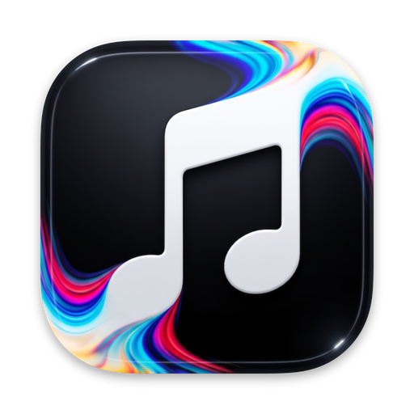
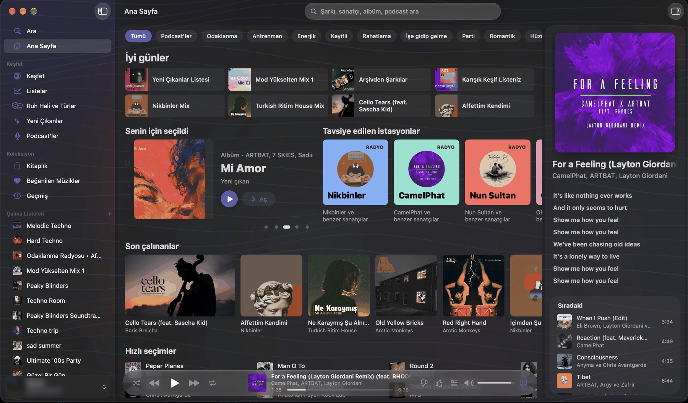
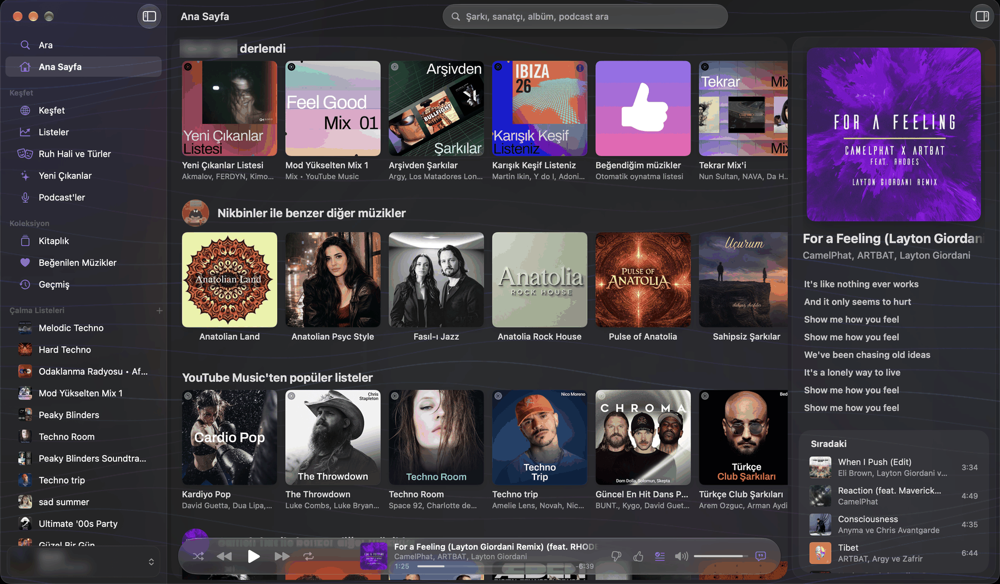
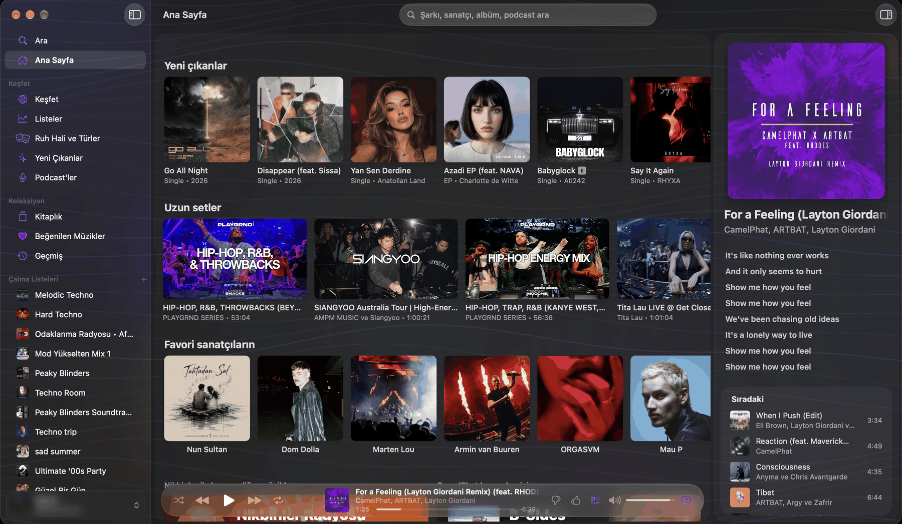
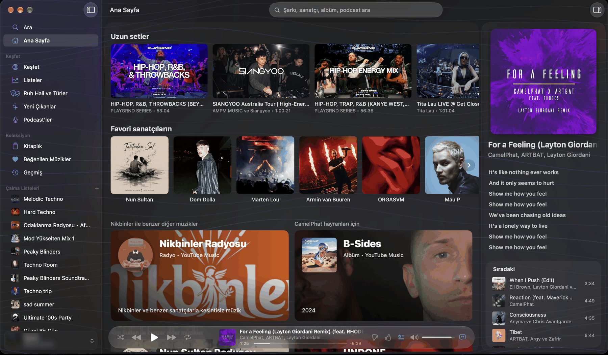
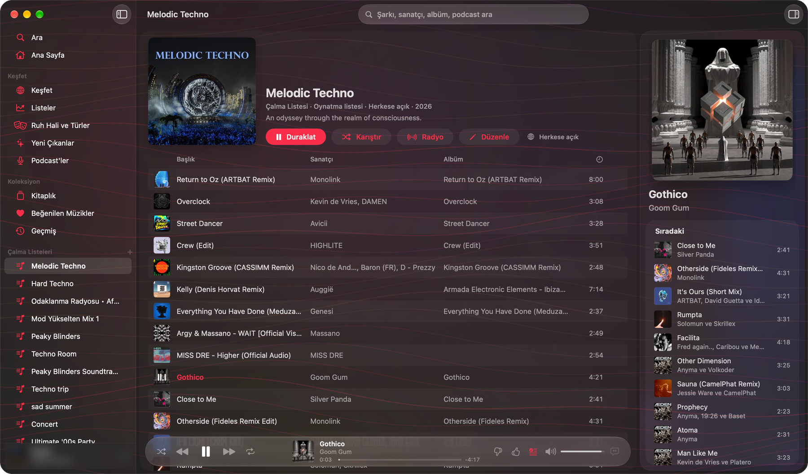
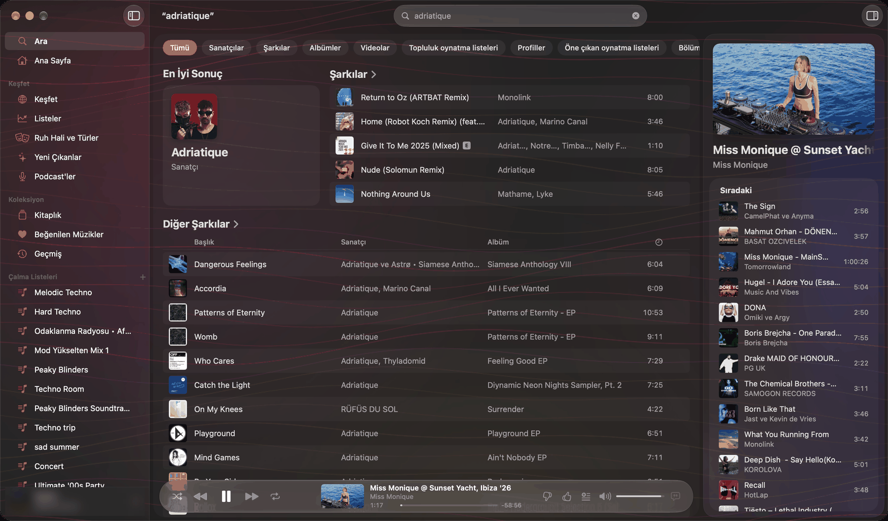
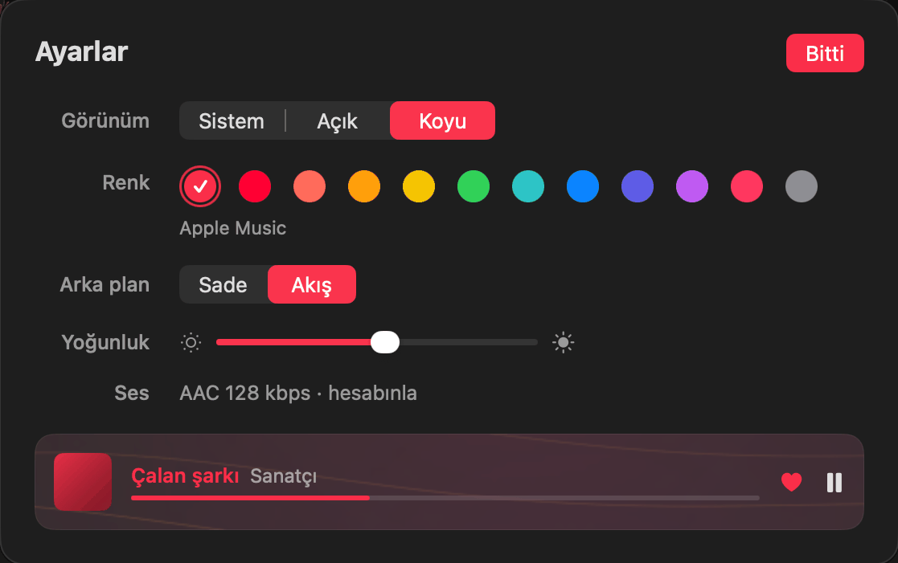
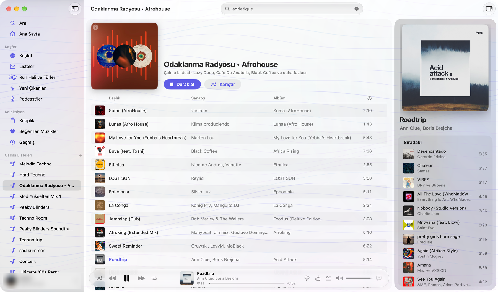

<p align="center">
  
</p>

<h1 align="center">YT Music for macOS</h1>

<p align="center">
  A native, lightweight YouTube Music client for the Mac — built with SwiftUI, in the spirit of Apple Music,<br>
  with a home page and recommendations of its own.
</p>

<p align="center">
  
  
  
  
</p>

<p align="center">
  <b>English</b> · <a href="README.tr.md">Türkçe</a>
</p>

<p align="center">
  
</p>

> **Unofficial.** This app is not affiliated with, endorsed by or sponsored by YouTube or Google. “YouTube” and “YouTube Music” are trademarks of Google LLC. You need your own YouTube Music account; YouTube Music Premium unlocks the highest audio quality.

---

## What's new in 2.1

- **Choose where the sound goes:** an output button in the player bar — the Mac's speakers, Bluetooth, USB or a display's speakers, for YT Music only and remembered; or AirPlay to an Apple TV, HomePod or AirPlay TV.
- **Starts at once:** hour-long DJ sets start in about a second and seek instantly (they used to take 12–30 seconds).
- **A new player bar:** the progress runs along the capsule's bottom edge, with elapsed and total time beside the song.
- **Smoother scrolling** while the home page loads.

## What's new in 2.0

Version 2.0 is about **what you hear next**. YouTube Music has a huge catalogue, but its home page and radios mix song versions, music videos, lyric videos and random re-uploads of the same track. 2.0 adds a recommendation layer of its own on top of YouTube Music, built around one idea: **a music app should feel like it knows you, and should never feel cluttered.**

### YouTube Music vs. YT Music for macOS 2.0

| | YouTube Music | YT Music for macOS 2.0 |
|---|---|---|
| **Radios** | Song versions, music videos and user uploads mixed together; the same song can come up in several uploads | **Official song versions first.** A music video is swapped for its song version, each song plays once, user uploads move to the back. DJ sets, mixes and radio shows are recognised and left alone |
| **Learning from you** | Server-side, out of sight | **An on-device listening profile.** A song finished counts for it, a skip within 30 seconds counts against it, old plays fade (half after 30 days). Fully readable, erasable, and it never leaves your Mac |
| **Home page** | “Listen again” on top for days, community playlists mixed in | **A Spotify-style home:** a greeting with 8 shortcuts, a pick of the day, radios of your artists, rows that change with what you listen to. No stale “Listen again” wall, no community playlists |
| **DJ sets and live recordings** | Mostly recommended on regular YouTube, rarely in YouTube Music | **“Long sets”** brings them in from regular YouTube — in the genres you listen to most (read from your playlists and the sets you played) and from your artists |
| **Notifications** | The bell, every channel mixed together and mostly Shorts | **“Notifications for you” at the top of home:** the last two weeks of regular uploads from the music channels you follow — artists, labels, festivals — no Shorts; the ones the bell announced and you haven't read are marked |
| **New releases** | A general new releases page | **What the artists you follow released in the last month** (found through your subscriptions, shown as the single or album), with a popular new release here and there |
| **“Don't recommend”** | Dislike for songs; “Not interested” on some home items | **Instant, everywhere:** the card shrinks away and the rest slide in. In “Up next”, the song leaves the queue and stays out of every future radio |
| **Thin rows** | Sometimes a row with a single card | **Every row is full or not shown at all** |

### The new home page

<p align="center">
  
</p>

From top to bottom:

- **Greeting and shortcuts** — “Good evening” and eight tiles with your mixes and what you played lately.
- **Notifications for you** — the regular uploads of the last 14 days from the music channels you subscribe to (no Shorts or Mixes), newest first, with each channel's picture. A channel counts as music when you follow it as an artist, when you listened to it here, or when YouTube files its videos under Music. Uploads your bell announced and you haven't read carry a dot; nothing is marked as read on YouTube.
- **Picked for you** — one release or editorial pick at a time, sliding to the next by itself, beside **Recommended stations**: the radios of the 15 artists you heard or followed most recently and the 15 you listen to longest, side by side.
- **Recently played**, **Quick picks** (a fresh random mix each time the page is rebuilt: YouTube Music's picks, songs from your saved playlists, what you played lately, worldwide hits and old favourites — at most two songs per artist), and **“Compiled for you”** with your personal mixes.
- **“More like …”** — the artists the fans of your favourite artists listen to.
- **Your top mixes**, **Jump back in** (long recordings you started), **Popular playlists from YouTube Music** (local and worldwide editorial lists in turn), **New releases**, **Long sets**, **Your favourite artists**.
- **Living cards** — one artist each, on the artist's wide YouTube Music banner that drifts slowly behind the card.

| | |
|---|---|
|  |  |
| **New releases and long sets** | **Living cards** |

Everything is built from YouTube Music, regular YouTube and your listening history, then kept in memory while the app runs: going back to the home page (or scrolling up again) shows it at once. It is rebuilt every 15 minutes, after five songs heard, when you follow or unfollow an artist, or with ⌘R — behind the page, and only the rows that changed fade over. The moving parts cost nothing: the banner drift is a Core Animation animation run by the system compositor, and it stops when the app is in the background.

## Why a native app

The YouTube Music website is a heavy web app. This is a real Mac app instead: no browser engine plays your music, nothing runs in a hidden web page, and it sits quietly in the background.

- **Native all the way.** SwiftUI interface, `AVPlayer` for audio, `JavaScriptCore` only to read YouTube Music's data format. No Electron, no web player.
- **Full quality.** With Premium, songs play as **256 kbps AAC** — the best stream YouTube Music offers — untouched: no re-encoding, no resampling.
- **Light.** About **1.5 % CPU** and **~170 MB** of memory while playing in the background (measured with version 1.0 on the author's MacBook).
- **At home on macOS.** Liquid Glass on macOS 26 and later, translucent sidebar, light and dark mode, your choice of accent colour.

## Screenshots

| | |
|---|---|
|  |  |
| **Playlists and albums** — play, shuffle, radio, edit your own playlists | **Artists** — popular songs, albums, singles, subscribe |
|  |  |
| **Time-synced lyrics** that follow the song; click a line to jump there | **Search** — top result, songs, albums, artists, playlists, videos |
|  |  |
| **Explore** — new releases, charts, moods and genres, podcasts | **Settings** — appearance, 12 accent colours, background |

<p align="center">
  
  <br><b>Light and dark mode</b> follow the system; the accent colour tints the whole app.
</p>

## Features

**Listening**
- The home page described above; Explore, New releases, Charts, Moods & genres and Podcasts. Mood pages show YouTube Music's official playlists and songs only.
- Album, playlist, artist, podcast and episode pages; your library, liked music and history.
- A real queue: “Up next”, radio and automix, shuffle and repeat, with the radio cleanup above.
- Your listening is reported to your YouTube account the way the official player does it — how much of a song you actually heard — so a song skipped after a few seconds doesn't count as listened, and YouTube's own recommendations improve too.
- The last song (and where you stopped) is back in the player when you open the app; the next song's first 10 seconds are loaded ahead, so songs change without a gap.
- Long DJ sets start in about a second and seek instantly: the player fetches only the pieces it needs (see How it works).
- Choose where the sound goes from the player bar: the Mac's speakers, Bluetooth, USB or a display's speakers — for YT Music only, remembered — or AirPlay (Apple TV, HomePod, AirPlay TVs and speakers).

**Your library**
- Create, rename, describe and delete playlists, and change their privacy.
- Add songs to playlists, remove and reorder them. The player shows when the playing song is already in one of your playlists.
- Like / dislike songs, subscribe to artists, “Don't recommend” anything.

**Lyrics and Now Playing**
- Side panel with the cover, lyrics (time-synced when available, via YouTube Music and [LRCLIB](https://lrclib.net)) and the queue.
- Media keys, Control Center / menu bar Now Playing (always in step with the app), Dock menu, keyboard shortcuts for everything.

**Design**
- Apple Music–style layout: translucent sidebar with playlist covers, floating glass player with the song's progress along its bottom edge, side panel.
- A calm, still background pattern in your accent colour (“Flow”), or plain.
- Adapts to the screen: roomy on a large display, denser on a laptop. Scroll arrows appear only when a row doesn't fit.
- Loading previews shaped like the page that is about to appear.
- Menus follow the system language (English or Turkish).

## Requirements

- macOS 14 Sonoma or later (Liquid Glass on macOS 26 and later)
- Apple's Command Line Tools (Xcode is not needed)
- A YouTube Music account (Premium for 256 kbps)

## Install

There is no signed download yet; you build the app yourself. It takes about a minute:

```bash
xcode-select --install          # once, if the Command Line Tools aren't installed

git clone https://github.com/demir1283/yt-music-macos.git
cd yt-music-macos
./build.sh --install            # builds "YT Music.app" and copies it to /Applications
```

`./build.sh` without `--install` builds the app in the project folder and opens it from there. Because the app is built on your own Mac, macOS doesn't show an “unidentified developer” warning.

On first launch, click **Sign in** in the sidebar and log in with Google.

**Upgrading from 1.0:** the app's identity changed in 2.0 (`io.github.demir1283.ytmusic`), so you sign in once more and settings start fresh.

## Keyboard shortcuts

| Shortcut | Action |
|---|---|
| Space | Play / pause |
| ⌥⌘→ / ⌥⌘← | Next / previous song |
| ⌘↑ / ⌘↓ | Volume up / down |
| ⌥⌘L | Like |
| ⌃⌘S / ⌃⌘R | Shuffle / repeat mode |
| ⌘F | Search (Esc leaves the search field) |
| ⌘1 … ⌘4 | Home, Explore, Library, Liked music |
| ⌘[ | Back |
| ⌥⌘P | Show / hide the side panel |
| ⇧⌘L | Lyrics |
| ⌘, | Settings |

## Privacy and security

- **Your password never touches the app.** Sign-in happens on Google's own page (shown in a sheet). The app only keeps the resulting session cookies, in macOS's standard per-app cookie store on your Mac. **Sign out** in the account menu removes them.
- **No accounts, servers, analytics or tracking of its own.** The app talks only to YouTube / Google (YouTube Music, and regular YouTube for sets, your subscriptions and your notifications) and LRCLIB (lyrics, sent the song title and artist).
- **Your listening history stays on your Mac.** It's what the recommendations learn from: one line per play (what, how much of it you heard, finished or skipped), capped at 4 MB, in `~/Library/Application Support`. Turn it off or erase it in **Settings → Geçmiş** (History).
- **Nothing else is written to disk.** While the app runs, pages and covers are kept **in memory** (covers up to 64 MB), so going back is instant; pages are fetched again after a few minutes, and quitting the app empties it all. Lyrics are not kept; songs stream with about a minute buffered in memory. Besides the history, the only file the app keeps is the prepared stream decoder for the current YouTube player version (~1 MB, in `~/Library/Caches`).
- **No keys or tokens in this repository.** Everything the app needs from YouTube is read at runtime from your own session.

## How it works

```
Google sign-in (sheet) ─▶ session cookies ─▶ URLSession
                                               │
YouTube Music + YouTube data APIs ◀── bridge.js in JavaScriptCore (pages, queues, feeds)
                                               │
Listening history ─▶ ListeningProfile ─▶ PersonalHome (home page) · QueueCurator (radios)
                                               │
Stream address ──▶ yt-dlp-ejs in JavaScriptCore (solves YouTube's stream challenge)
                                               │
              DashToHLS (a playlist from the audio file's own index)
                                               │
                         AVPlayer ──▶ Mac output or AirPlay (256 kbps AAC with Premium)
```

```
Sources/YTMusicMac/
  App/       app entry, menus, Dock menu, navigation model
  Engine/    YTMusic (the engine), NativeCore (JavaScriptCore on its own queue + HTTP),
             StreamResolver, SigSolver, DashToHLS, AudioPlayer, AudioOutputs,
             NowPlayingBridge, SyncedLyrics, Models,
             QueueCurator (radio cleanup), ListeningLog + ListeningProfile (history),
             PersonalHome (the home page)
  Support/   theme, density, images, view-state helper
  Views/     window, sidebar, player bar, side panel, pages, shelves, home rows,
             loading previews
Tools/bridge.js     readable source of the embedded bridge (Engine/BridgeScript.swift)
Resources/          app icon, yt-dlp-ejs
```

If you edit `Tools/bridge.js`, copy it into `Engine/BridgeScript.swift` as well.

## Troubleshooting

- **Pages stay empty:** use **Reconnect** in the View menu; if YouTube shows a consent page, open YouTube Music in the browser once (⇧⌘Y).
- **Diagnostics:** `defaults write io.github.demir1283.ytmusic diagnosticLog -bool true` writes `YT Music.log` next to the app; `defaults delete io.github.demir1283.ytmusic diagnosticLog` turns it off. Read the log before sharing it anywhere.

## Credits

- [yt-dlp-ejs](https://github.com/yt-dlp/ejs) (public domain), bundling [meriyah](https://github.com/meriyah/meriyah) (ISC) and [astring](https://github.com/davidbonnet/astring) (MIT) — solves YouTube's stream challenge.
- [LRCLIB](https://lrclib.net) — open, time-synced lyrics.
- Design inspired by Apple Music, Spotify's home page and the open-source [Kaset](https://github.com/sozercan/kaset).

## License

[MIT](LICENSE). The bundled yt-dlp-ejs keeps its own licence (`Resources/ejs/LICENSE`).
