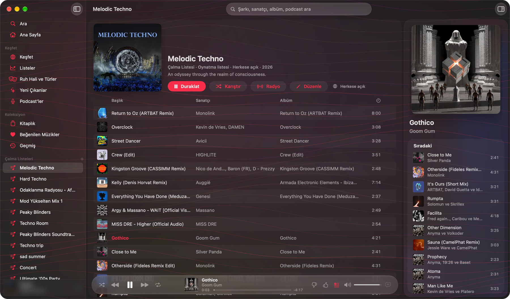
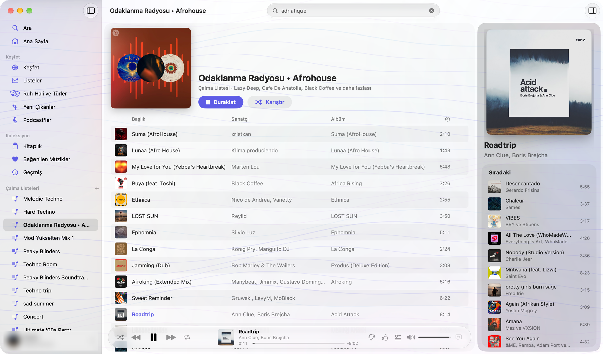

<p align="center">
  
</p>

<h1 align="center">macOS için YT Music</h1>

<p align="center">
  Mac için native ve hafif bir YouTube Music istemcisi — SwiftUI ile, Apple Music havasında.
</p>

<p align="center">
  
  
  
  
</p>

<p align="center">
  <a href="README.md">English</a> · <b>Türkçe</b>
</p>

<p align="center">
  
</p>

> **Resmi değildir.** Bu uygulamanın YouTube veya Google ile bir bağlantısı yoktur; onlar tarafından onaylanmamış ya da desteklenmemiştir. “YouTube” ve “YouTube Music”, Google LLC'nin ticari markalarıdır. Kendi YouTube Music hesabın gerekir; en yüksek ses kalitesi için YouTube Music Premium gerekir.

---

## Neden

YouTube Music'in web sitesi ağır bir web uygulaması. Bu ise gerçek bir Mac uygulaması: müziği bir tarayıcı motoru çalmıyor, gizli bir web sayfası çalışmıyor ve arka planda sessizce duruyor.

- **Baştan sona native.** Arayüz SwiftUI, ses `AVPlayer`; `JavaScriptCore` yalnızca YouTube Music'in veri biçimini çözmek için. Electron yok, web oynatıcı yok.
- **Tam kalite.** Premium ile şarkılar YouTube Music'in sunduğu en iyi akış olan **256 kbps AAC** olarak, hiç dokunulmadan çalar: yeniden kodlama ya da örnekleme yok.
- **Hafif.** Arka planda çalarken yaklaşık **%1,5 işlemci** ve **~170 MB** bellek (geliştiricinin MacBook'unda ölçüldü).
- **macOS'a yakışır.** macOS 26 ve sonrasında Liquid Glass, yarı saydam kenar çubuğu, açık ve koyu görünüm, istediğin vurgu rengi.

## Ekran görüntüleri

| | |
|---|---|
|  |  |
| **Çalma listeleri ve albümler** — çal, karıştır, radyo, kendi listelerini düzenle | **Sanatçılar** — popüler şarkılar, albümler, single'lar, abone ol |
|  |  |
| **Zamanlı şarkı sözleri** şarkıyla akar; bir satıra tıklayınca oraya atlar | **Arama** — en iyi sonuç, şarkılar, albümler, sanatçılar, listeler, videolar |
|  |  |
| **Keşfet** — yeni çıkanlar, listeler, ruh halleri ve türler, podcast'ler | **Ayarlar** — görünüm, 12 vurgu rengi, arka plan |

<p align="center">
  
  <br><b>Açık ve koyu görünüm</b> sistemi izler; vurgu rengi tüm uygulamayı renklendirir.
</p>

## Özellikler

**Dinleme**
- Hızlı seçimler, mix'ler ve kategori düğmeleriyle ana sayfa; Keşfet, Yeni Çıkanlar, Listeler, Ruh Hali ve Türler, Podcast'ler.
- Albüm, çalma listesi, sanatçı, podcast ve bölüm sayfaları; kitaplığın, beğendiğin müzikler ve geçmişin.
- Gerçek bir sıra: "Sıradaki", radyo ve otomatik mix, karıştırma ve tekrar. Beğenmediğin şarkılar sıralarına girmez.
- Uygulamayı açtığında son çaldığın şarkı (ve kaldığın yer) oynatıcıda hazır bekler.
- Sıradaki şarkının ilk 10 saniyesi önceden yüklenir; şarkılar boşluksuz değişir.

**Kitaplığın**
- Çalma listesi oluşturma, adını ve açıklamasını değiştirme, silme, gizlilik ayarı.
- Listeye şarkı ekleme, çıkarma ve sıralama. Çalan şarkı listelerinden birindeyse oynatıcıda görünür.
- Şarkı beğenme / beğenmeme, sanatçılara abone olma.

**Şarkı sözleri ve Şu An Çalan**
- Kapak, şarkı sözleri (varsa zamanlı; YouTube Music ve [LRCLIB](https://lrclib.net) üzerinden) ve sırayla yan panel.
- Medya tuşları, Denetim Merkezi / menü çubuğunda Şu An Çalan, Dock menüsü, her şey için klavye kısayolu.

**Tasarım**
- Apple Music tarzı düzen: yarı saydam kenar çubuğu, yüzen cam oynatıcı, yan panel.
- Vurgu renginde sakin, durağan bir arka plan deseni ("Akış") ya da sade arka plan.
- Ekrana uyum: büyük ekranda ferah, dizüstünde daha sıkı; kaydırmadan daha çok içerik sığar.
- Menüler sistem dilini izler (Türkçe veya İngilizce).

## Gereksinimler

- macOS 14 Sonoma veya sonrası (Liquid Glass için macOS 26 ve sonrası)
- Apple Command Line Tools (Xcode gerekmez)
- Bir YouTube Music hesabı (256 kbps için Premium)

## Kurulum

Henüz imzalı bir indirme yok; uygulamayı kendin derliyorsun. Yaklaşık bir dakika sürer:

```bash
xcode-select --install          # bir kez, Command Line Tools kurulu değilse

git clone https://github.com/demir1283/yt-music-macos.git
cd yt-music-macos
./build.sh --install            # "YT Music.app"i derler ve /Applications'a kopyalar
```

`--install` olmadan `./build.sh`, uygulamayı proje klasöründe derleyip oradan açar. Uygulama kendi Mac'inde derlendiği için macOS "tanımlanamayan geliştirici" uyarısı göstermez.

İlk açılışta kenar çubuğundaki **Oturum Aç** ile Google hesabına giriş yap.

## Klavye kısayolları

| Kısayol | İşlev |
|---|---|
| Boşluk | Çal / duraklat |
| ⌥⌘→ / ⌥⌘← | Sonraki / önceki şarkı |
| ⌘↑ / ⌘↓ | Sesi aç / kıs |
| ⌥⌘L | Beğen |
| ⌃⌘S / ⌃⌘R | Karıştır / tekrarlama modu |
| ⌘F | Ara |
| ⌘1 … ⌘4 | Ana Sayfa, Keşfet, Kitaplık, Beğenilen Müzikler |
| ⌘[ | Geri |
| ⌥⌘P | Yan paneli göster / gizle |
| ⇧⌘L | Şarkı sözleri |
| ⌘, | Ayarlar |

## Gizlilik ve güvenlik

- **Parolan uygulamaya hiç uğramaz.** Giriş, Google'ın kendi sayfasında (bir pencerede) yapılır. Uygulama yalnızca oluşan oturum çerezlerini, Mac'inde macOS'un uygulamaya özel standart çerez deposunda tutar. Hesap menüsündeki **Oturumu Kapat** bunları siler.
- **Kendine ait hesap, sunucu, analiz ya da izleme yok.** Uygulama yalnızca YouTube / Google (müzik, kitaplığın) ve LRCLIB (şarkı sözleri; şarkı adı ve sanatçıyla) ile konuşur.
- **Önbellek yok.** Kapaklar, sayfalar ve şarkı sözleri diske yazılmaz; şarkılar akışla çalar ve bellekte yaklaşık bir dakikalık tampon tutulur. Uygulamanın sakladığı tek dosya, güncel YouTube oynatıcı sürümü için hazırlanan akış çözücüsüdür (~1 MB, `~/Library/Caches` içinde).
- **Bu depoda anahtar ya da token yok.** Uygulamanın YouTube'dan ihtiyaç duyduğu her şey çalışırken senin oturumundan okunur.

## Nasıl çalışır

```
Google girişi (pencere) ─▶ oturum çerezleri ─▶ URLSession
                                               │
YouTube Music veri API'si ◀── JavaScriptCore'da bridge.js (sayfalar, sıralar, sözler)
                                               │
Akış adresi ──▶ JavaScriptCore'da yt-dlp-ejs (YouTube'un akış sınamasını çözer)
                                               │
                     AVPlayer ──▶ macOS ses sistemi (Premium ile 256 kbps AAC)
```

```
Sources/Encore/
  App/       giriş noktası, menüler, Dock menüsü, gezinme modeli
  Engine/    YTMusic (motor), NativeCore (JavaScriptCore + HTTP), StreamResolver,
             SigSolver, AudioPlayer, NowPlayingBridge, SyncedLyrics, Models
  Support/   tema, yoğunluk, görseller, view-state yardımcısı
  Views/     pencere, kenar çubuğu, oynatma barı, yan panel, sayfalar, raflar, yükleme önizlemeleri
Tools/bridge.js     gömülü köprünün okunabilir kaynağı (Engine/BridgeScript.swift)
Resources/          uygulama simgesi, yt-dlp-ejs
```

`Tools/bridge.js` dosyasını değiştirirsen `Engine/BridgeScript.swift` içine de kopyala.

## Sorun giderme

- **Sayfalar boş kalıyor:** Görüntü menüsündeki **Bağlantıyı Yeniden Kur**'u kullan; YouTube bir onay sayfası gösteriyorsa YouTube Music'i bir kez tarayıcıda aç (⇧⌘Y).
- **Tanılama:** `defaults write local.encore.player diagnosticLog -bool true` uygulamanın yanına `YT Music.log` yazar; `defaults delete local.encore.player diagnosticLog` kapatır. Günlüğü okumadan herkese açık paylaşma.
- **Performans:** `./profile.sh` işlemci ve belleği ölçer, 10 saniyelik bir örnek alır (`profile.txt`).

## Teşekkürler

- [yt-dlp-ejs](https://github.com/yt-dlp/ejs) (kamu malı); içinde [meriyah](https://github.com/meriyah/meriyah) (ISC) ve [astring](https://github.com/davidbonnet/astring) (MIT) — YouTube'un akış sınamasını çözer.
- [LRCLIB](https://lrclib.net) — açık, zamanlı şarkı sözleri.
- Tasarımda Apple Music ve açık kaynaklı [Kaset](https://github.com/sozercan/kaset) ilham kaynağı oldu.

## Lisans

[MIT](LICENSE). Uygulamayla gelen yt-dlp-ejs kendi lisansını korur (`Resources/ejs/LICENSE`).
