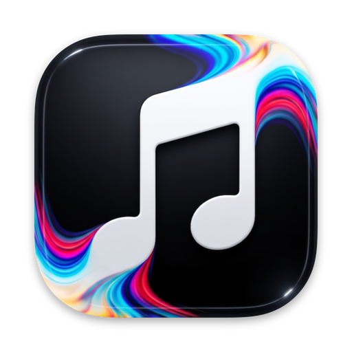
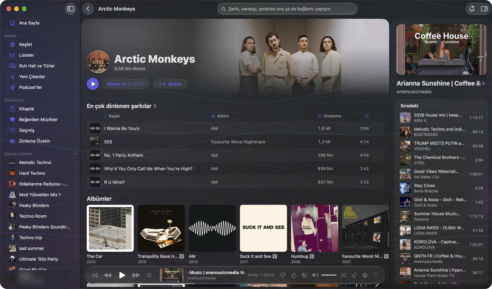
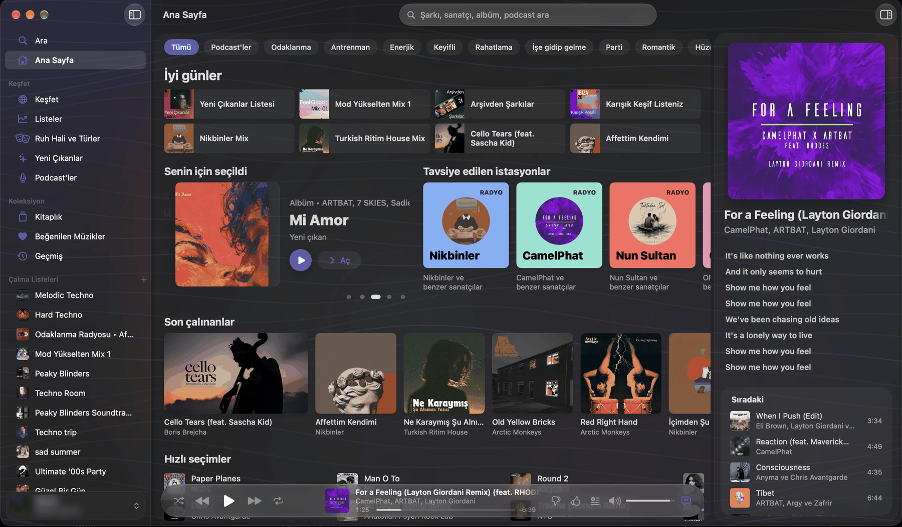
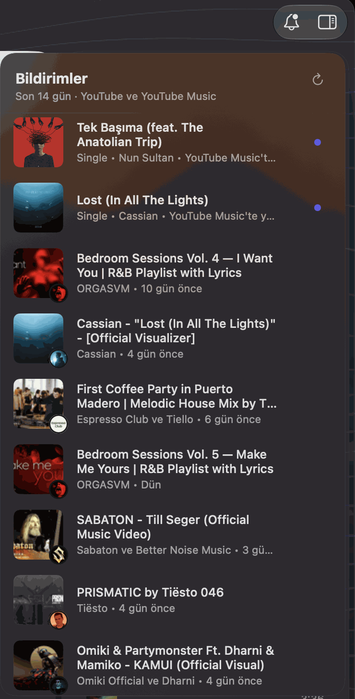

<p align="center">
  
</p>

<h1 align="center">YT Music for macOS</h1>

<p align="center">
  <b>YouTube Music'in Mac'e özel, yerel uygulaması — kendi ana sayfası, kendi oynatıcısı ve kendi tasarımıyla.</b>
</p>

<p align="center">
  
  
  
  
</p>

<p align="center">
  <a href="README.md">English</a> · <b>Türkçe</b>
</p>

<p align="center">
  
</p>

<p align="center">
  <a href="#kurulum"><b>Kurulum</b></a> · <a href="#özellikler">Özellikler</a> · <a href="#gizlilik">Gizlilik</a> · <a href="CHANGELOG.md">Değişiklikler</a>
</p>

YT Music, Mac için SwiftUI ile sıfırdan yazılmış bir YouTube Music istemcisi. Kendi hesabınla giriş yapar, kendi kitaplığını ve YouTube Music'in bütün kataloğunu dinlersin; ama karşına çıkan şey bir pencereye konmuş YouTube Music web sayfası değildir. Ana sayfada ne olacağına, bir radyonun sırada ne çalacağına, senin için neyin yeni olduğuna uygulama kendisi karar verir — bu Mac'te dinlediklerine göre — ve hepsini Apple'ın kendi ses oynatıcısıyla çalar.

> **Resmî değildir.** YouTube veya Google ile bağlantısı yoktur. “YouTube” ve “YouTube Music”, Google LLC'nin ticari markalarıdır. Kendi YouTube Music hesabın gerekir; en iyi ses kalitesi için Premium gerekir.

## Onu farklı kılan

<table>
<tr>
<td width="33%" valign="top">

### Kendi algoritması

Ana sayfa YouTube Music'in akışı değildir. Her açtığında Mac'inde yeniden kurulur: dinleme geçmişinden, takip ettiğin sanatçılardan, YouTube Music'in kataloğundan ve normal YouTube'dan. Sanatçı istasyonları, hızlı seçimler, en çok dinlediğin sanatçıların etrafında mix'ler, sevdiğin sanatçılara benzeyenler, dinlediğin türlerde uzun setler. Radyolar düzenlenir — önce resmî sürümler, her şarkı bir kez — yeni çıkanlar ve bildirimler yalnızca takip ettiğin sanatçı ve kanallardan gelir.

</td>
<td width="33%" valign="top">

### Kendi tasarımı

İlk satırından itibaren Mac için tasarlandı ve yazıldı: yavaşça akan bir ortam arka planı, sanatçıların kendi fotoğraflarıyla dikey istasyon kartları, kendiliğinden dönen bir öneri destesi, sanatçının portresiyle açılan sanatçı sayfaları, dinleme özetin ve şarkı sözleriyle sıra için bir yan panel. Hiçbir şey birden belirmez: görünümler solarak gelir, şarkılar yumuşakça açılıp kısılır. macOS 26'da Liquid Glass, açık ve koyu mod, seçilebilir vurgu renkleri.

</td>
<td width="33%" valign="top">

### Kendi oynatıcısı

İçinde tarayıcı da web oynatıcı da yok: YouTube'un gönderdiği akış, Apple'ın AVPlayer'ı ile olduğu gibi çalınır — Premium ile 256 kbps AAC. Şarkılar arasında eşit ses, şarkılar arası geçiş, uyku zamanlayıcı ve uygulamaya özel ses çıkışı (hoparlör, Bluetooth, USB, ekran ya da AirPlay). Arka planda çalarken yaklaşık %1,5 işlemci ve ~170 MB bellek.

</td>
</tr>
</table>

## Yakından

<table>
<tr>
<td width="75%"></td>
<td width="25%"></td>
</tr>
<tr>
<td align="center"><sub>Kendine ait bir ana sayfa · senin için seçilenler, takip ettiğin sanatçılar ve değişen karşılama</sub></td>
<td align="center"><sub>Takip ettiğin sanatçı ve kanallardan yeni müzik</sub></td>
</tr>
</table>

## Özellikler

**Dinleme**
- Şarkılar arasında eşit ses; her şarkının ses yüksekliği YouTube'un ölçümüne göre ayarlanır.
- Çalar çubuğundaki düğmeden 3–12 saniyelik şarkılar arası geçiş; sırasıyla çalınan bir albümde ya da DJ setinde yapılmaz.
- Çalma, duraklatma ve şarkı değiştirme yumuşakça açılıp kısılır; kendiliğinden biten şarkı sıradakine olduğu gibi geçer.
- Uyku zamanlayıcı: 15 dakikadan 1,5 saate kadar ya da şarkı bitince, sesi kısarak.
- Yan panelde zamanlı şarkı sözleri ve sıra; yalnızca bu uygulama için ses çıkışı.

**Keşif**
- Senin için kurulan bir ana sayfa: sanatçı istasyonları, hızlı seçimler, mix'ler, benzer sanatçılar ve uzun setler.
- Takip ettiğin ve dinlediğin sanatçıların yeni çıkanları.
- Takip ettiğin sanatçı ve kanallardan son müzikleri gösteren bir zil — single, albüm ve yüklemeler, Shorts olmadan.
- Dinleme özetin: haftanın, ayın, yılın ya da tüm zamanların sanatçıları, kanalları ve şarkıları.

**Kitaplığın**
- Çalma listeleri, albümler, sanatçılar, beğendiklerin ve geçmişin; çalma listesi oluşturma, düzenleme ve sıralama.
- Yazarken öneriler sunan arama.
- Beğenmediğin içerik tek yerde, istediğin an geri alınabilir.

**Mac'te**
- Medya tuşları, Denetim Merkezi, Dock menüsü ve klavye kısayolları.
- Türkçe ya da İngilizce; Mac'inin diline ya da senin seçimine göre.
- Uygulama içinden güncelleme ve müzik çalarken çıkmadan önce bir soru.

## Yenilikler

- **3.4 — Yeni sanatçı sayfaları ve kapaklı Ruh Hali ve Türler:** bannerı sayfaya yumuşakça karışan, sanatçının yuvarlak fotoğrafını adının yanında gösteren sanatçı sayfaları; albüm ve çalma listelerinde Dinlenme sütunu; her ruh hali ve tür, kendi renginde, bölgendeki en üst listelerinin kapaklarını taşıyan bir kart; kapağın rengi karta yayılır, üzerine gelince kapaklar deste gibi açılır; albümler, çalma listeleri ve podcast'ler kendi sayfalarından kitaplığa eklenir; her YouTube Music ya da YouTube bağlantısı arama alanından açılır.
- **3.3 — Ekranı dolduran ızgaralar:** her yerde tek kart ızgarası, videolar gerçek boyutlarında; az içerikli sanatçı sayfaları satırlarını ekranı dolduracak şekilde açar, "Daha Fazla Göster" kalanını ikişer satır getirir; on dakikada bir değişen karşılama cümleleri; daha az saydam çalar çubuğu; Türkçe ve İngilizce artık karışmıyor.
- **3.2 — Disk görüntüsü ve yeni Kitaplık:** YT-Music.dmg'den uygulamayı sürükleyerek kurulum, Terminal gerekmez; çipler, kutucuk ya da liste görünümü ve üç sıralamayla, takip ettiğin bütün sanatçılar, albümler ve çalma listeleriyle yeni Kitaplık, ••• menüsünden kitaplıktan kaldırma; sanatçı sayfalarında şarkı süreleri ve çıkış yılları. 3.2.1, "Senin için seçildi"yi kaydırarak gezilen geniş kartlara çevirir ve bildirimleri yeniden eskiye sıralar.
- **3.1 — Bildirimler ve şarkılar arası geçiş:** takip ettiğin sanatçı ve kanalların yeni single, albüm ve yüklemelerini gösteren bir zil; çalar çubuğundan şarkılar arası geçiş; çalma ve duraklatma yumuşakça açılıp kısılır. 3.1.1, YouTube'un yeni oynatıcısıyla şarkıların çalmaya devam etmesini sağlar.
- **3.0 — Eşit ses, uyku zamanlayıcı, dinleme özetin:** dinleme özetin, sanatçıların kendi fotoğraflarıyla yenilenen ana sayfa ve sanatçı sayfaları, açılabilen mix'ler ve geri alınabilen beğenilmeyen içerik.
- **2.7 — Uygulama içinden güncelleme:** yeni sürüm kenar çubuğunda görünür; tek tıkla indirilip derlenir.

Tam liste [değişiklik günlüğünde](CHANGELOG.md).

## Kurulum

<p>
  <a href="https://github.com/demir1283/yt-music-macos/releases/latest/download/YT-Music.dmg"><b>⬇︎ YT Music'i indir (.dmg)</b></a> — macOS 14 veya üstü, Apple Silicon ve Intel
</p>

1. **YT-Music.dmg**'yi aç ve **YT Music**'i **Uygulamalar** klasörüne sürükle.
2. YT Music'i aç. İlk seferde macOS uygulamayı doğrulayamadığını söyler — uygulama ücretli bir Apple geliştirici sertifikasıyla imzalı değil. **Bitti**'ye tıkla.
3. **Sistem Ayarları → Gizlilik ve Güvenlik**'i aç, **Güvenlik** bölümüne kadar in ve YT Music'in yanındaki **Yine de Aç**'a tıkla, ardından parolanla onayla. Bu yalnızca bir kez gerekir.
4. Kenar çubuğunda **Giriş yap**'a tıklayıp Google ile giriş yap.

### Güncelleme

Uygulama açılışta ve günde bir kez GitHub'da yeni sürüm olup olmadığına bakar. Yeni sürüm çıktığında kenar çubuğunda görünür; **Güncelle** onu indirir, yerine koyar ve uygulamayı yeniden açar — bu kez macOS bir şey sormaz. Denetimi **Ayarlar → Güncelleme**'den kapatabilirsin. Her sürümde e-posta almak için bu sayfada **Watch → Custom → Releases**'ı seç.

### Kaynaktan derleme

Kendin derlemeyi tercih edersen (yaklaşık bir dakika, Xcode gerekmez):

```bash
xcode-select --install          # bir kez, Command Line Tools kurulu değilse
git clone https://github.com/demir1283/yt-music-macos.git
cd yt-music-macos
./build.sh --install            # uygulamayı derler ve /Applications'a kopyalar
```

Böyle derlenen kopya kendini aynı klasörden günceller: **Güncelle** orada `git pull` ve `./build.sh` çalıştırır. Elle: `git pull && ./build.sh --install`.

## Klavye kısayolları

| Kısayol | İşlem |
|---|---|
| Boşluk | Çal / duraklat |
| ⌥⌘→ / ⌥⌘← | Sonraki / önceki şarkı |
| ⌘↑ / ⌘↓ | Sesi aç / kıs |
| ⌥⌘L | Beğen |
| ⌘F | Ara (öneri seçmek için ↑↓, kapatmak için Esc) |
| ⌘1 … ⌘4 | Ana sayfa, Keşfet, Kitaplık, Beğenilen müzikler |
| ⌘[ | Geri |
| ⇧⌘L | Şarkı sözleri |
| ⌘, | Ayarlar |

## Gizlilik

- **Parolan uygulamaya hiç ulaşmaz.** Google'ın kendi sayfasında giriş yaparsın; uygulama yalnızca oturum çerezlerini Mac'inde tutar. **Çıkış yap** onları siler.
- **Sunucu, analiz veya izleme yok.** Uygulama yalnızca YouTube / Google, [LRCLIB](https://lrclib.net) (şarkı sözleri) ve GitHub (yeni sürüm var mı diye; Ayarlar'dan kapatılabilir) ile konuşur.
- **Dinleme geçmişin Mac'inde kalır** (en fazla 4 MB). Ayarlar'dan kapatabilir veya silebilirsin.
- **Bu depoda anahtar veya token yok.** Her şey çalışırken senin oturumundan okunur.

<details>
<summary><b>Nasıl çalışır</b></summary>

```
Google girişi ─▶ oturum çerezleri ─▶ URLSession
                                       │
YouTube Music + YouTube verisi ◀── JavaScriptCore'da bridge.js
                                       │
Dinleme geçmişi ─▶ ListeningProfile ─▶ ana sayfa · radyo temizliği · yeni çıkanlar
                                       │
Akış adresi ──▶ yt-dlp-ejs (YouTube'un akış sınamasını çözer)
                                       │
          DashToHLS (ses dosyasının kendi dizininden bir çalma listesi)
                                       │
                 AVPlayer ──▶ seçilen çıkış veya AirPlay
```

`Tools/bridge.js` dosyasını düzenlersen Swift kopyasını `./build.sh` (ya da `Tools/gen-bridge.sh`) yazar. Testler: `swift test` (Xcode gerekir) ve `node --test "Tools/tests/*.test.mjs"`; GitHub Actions her push'ta ikisini de çalıştırır.
</details>

<details>
<summary><b>Sorun giderme</b></summary>

- **Sayfalar boş kalıyor:** Görünüm menüsünden **Yeniden bağlan**'ı kullan. YouTube bir onay sayfası gösteriyorsa YouTube Music'i bir kez tarayıcıda aç (⇧⌘Y).
- **Tanı kaydı:** `defaults write io.github.demir1283.ytmusic diagnosticLog -bool true` uygulamanın yanına `YT Music.log` yazar (bir önceki oturumunki `YT Music (önceki).log` olarak saklanır); `defaults delete io.github.demir1283.ytmusic diagnosticLog` kapatır. Paylaşmadan önce kaydı oku.
- **1.0'dan yükseltme:** bir kez daha giriş yap; ayarlar sıfırdan başlar.
</details>

## Geri bildirim

- **Hata mı buldun, bir özellik mi istiyorsun?** [Issue aç](https://github.com/demir1283/yt-music-macos/issues/new/choose); her biri için kısa bir form var.
- **Sorun veya fikrin mi var?** [Tartışmalar](https://github.com/demir1283/yt-music-macos/discussions) bölümünü kullan.
- **Güvenlik sorunu mu?** Herkese açık issue yerine [Güvenlik sekmesinden](https://github.com/demir1283/yt-music-macos/security/advisories/new) özel olarak bildir.

Türkçe de İngilizce de olur. Hesap adını, çerezleri veya token'ları asla paylaşma.

## Teşekkürler

- [yt-dlp-ejs](https://github.com/yt-dlp/ejs) (kamu malı), [meriyah](https://github.com/meriyah/meriyah) (ISC) ve [astring](https://github.com/davidbonnet/astring) (MIT) ile.
- Eşzamanlı şarkı sözleri için [LRCLIB](https://lrclib.net).
- [Kaset](https://github.com/sozercan/kaset), Mac için yerel bir YouTube Music istemcisinin neye benzeyebileceğini erkenden gösterdiği için.

## Lisans

[MIT](LICENSE). Pakete dahil yt-dlp-ejs kendi lisansını korur (`Resources/ejs/LICENSE`).
