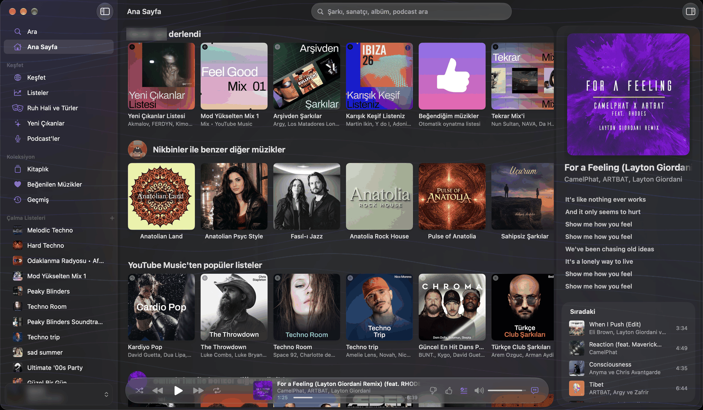
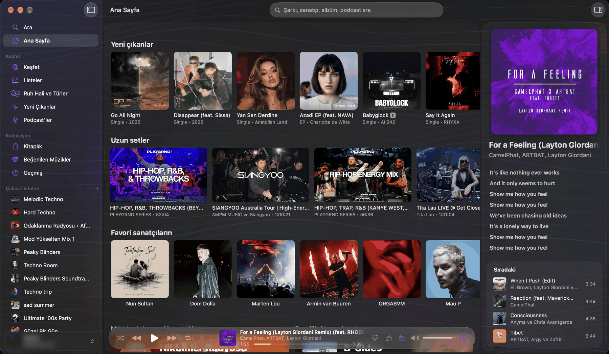
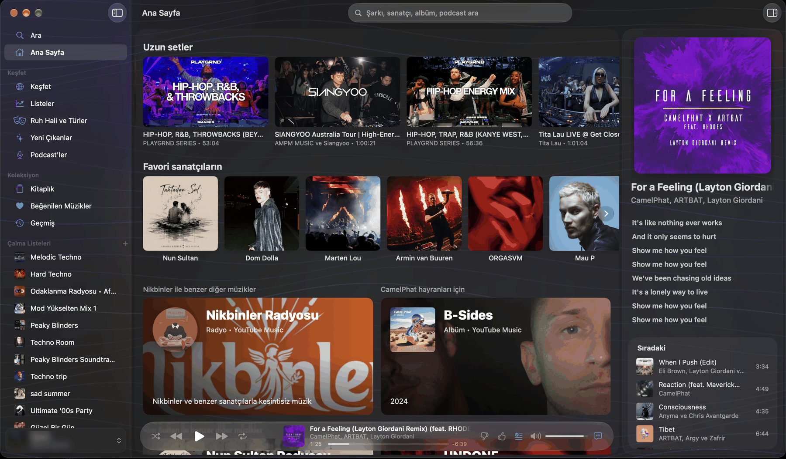
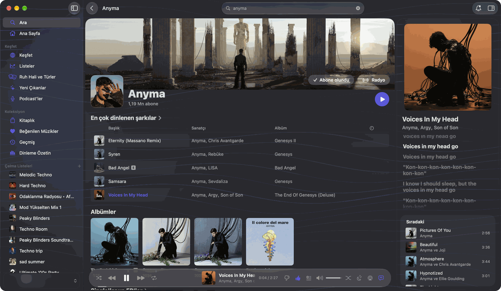
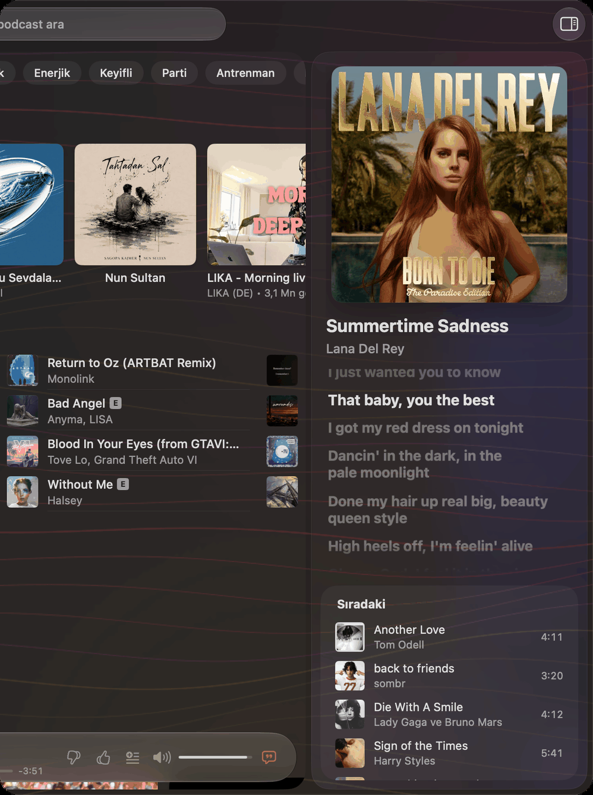
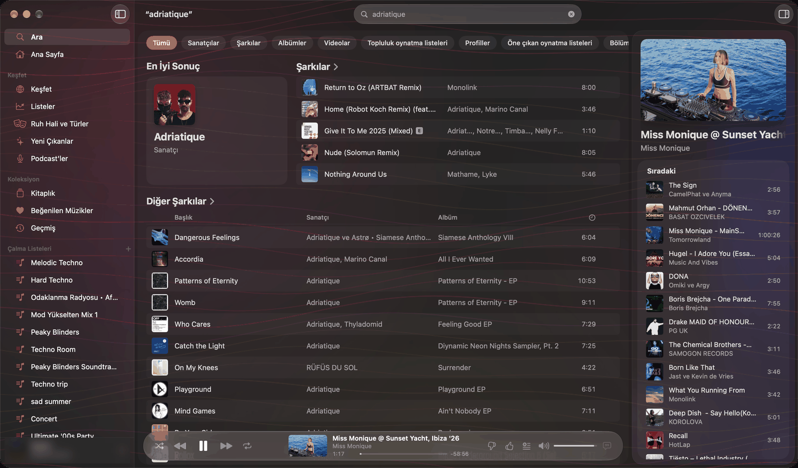
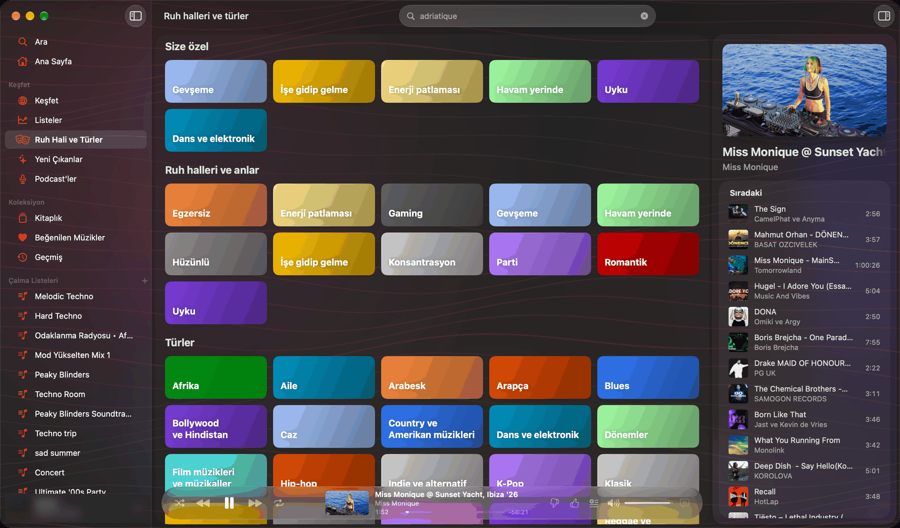
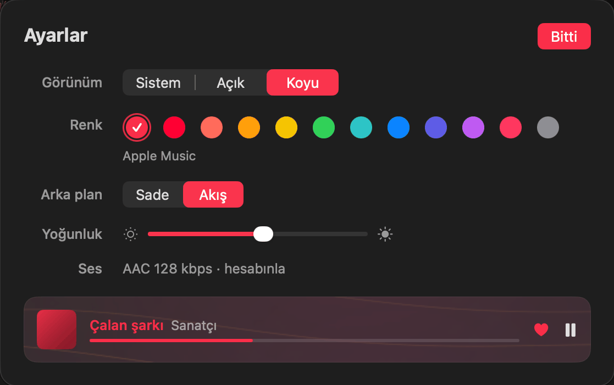

<p align="center">
  
</p>

<h1 align="center">macOS için YT Music</h1>

<p align="center">
  Mac için native ve hafif bir YouTube Music istemcisi — SwiftUI ile, Apple Music havasında,<br>
  kendine ait bir ana sayfa ve öneri sistemiyle.
</p>

<p align="center">
  
  
  
  
</p>

<p align="center">
  <a href="README.md">English</a> · <b>Türkçe</b>
</p>

<p align="center">
  
</p>

> **Resmi değildir.** Bu uygulamanın YouTube veya Google ile bir bağlantısı yoktur; onlar tarafından onaylanmamış ya da desteklenmemiştir. “YouTube” ve “YouTube Music”, Google LLC'nin ticari markalarıdır. Kendi YouTube Music hesabın gerekir; en yüksek ses kalitesi için YouTube Music Premium gerekir.

---

## 2.1'de neler yeni

- **Sesin nereden çıkacağını sen seç:** oynatıcı çubuğunda yeni bir çıkış düğmesi — Mac'in hoparlörleri, Bluetooth, USB ya da monitörün hoparlörleri, yalnızca YT Music için ve hatırlanarak; ya da AirPlay ile Apple TV, HomePod veya AirPlay destekli bir TV.
- **Anında başlar:** saatlik DJ setleri yaklaşık bir saniyede başlar ve ileri sarma anında olur (önceden 12–30 saniye sürüyordu).
- **Yeni oynatıcı çubuğu:** ilerleme kapsülün alt kenarı boyunca akar, şarkının yanında geçen ve toplam süre.
- Ana sayfa yüklenirken **daha akıcı kaydırma**.

## 2.0'da neler yeni

2.0'ın konusu **sıradaki müzik**. YouTube Music'in kataloğu devasa, ama ana sayfası ve radyoları şarkı sürümlerini, müzik videolarını, sözlü videoları ve aynı şarkının rastgele yeniden yüklemelerini birbirine karıştırıyor. 2.0, YouTube Music'in üzerine kendi öneri katmanını ekliyor ve tek bir fikre dayanıyor: **bir müzik uygulaması seni tanıyormuş gibi hissettirmeli ve asla karmaşık görünmemeli.**

### YouTube Music ve macOS için YT Music 2.0

| | YouTube Music | macOS için YT Music 2.0 |
|---|---|---|
| **Radyolar** | Şarkı sürümleri, müzik videoları ve kullanıcı yüklemeleri bir arada; aynı şarkı birden fazla yüklemeyle gelebiliyor | **Önce resmi şarkı sürümleri.** Müzik videosu, varsa şarkı sürümüyle değişir; her şarkı bir kez çalar; kullanıcı yüklemeleri sona geçer. DJ setleri, mix'ler ve radyo şovları tanınır ve olduğu gibi bırakılır |
| **Senden öğrenmek** | Sunucu tarafında, görünmeden | **Cihazda tutulan bir dinleme profili.** Sonuna kadar dinlenen şarkı lehine, ilk 30 saniyede geçilen şarkı aleyhine sayılır; eski dinlemelerin etkisi azalır (30 günde yarıya iner). Okunabilir, silinebilir ve Mac'inden hiç çıkmaz |
| **Ana sayfa** | Günlerce en üstte duran “Yeniden dinleyin”, araya karışan topluluk listeleri | **Spotify tarzı bir ana sayfa:** 8 kısayollu selamlama, günün seçimi, sanatçılarının radyoları, dinlediklerinle değişen raflar. Bayatlayan “Yeniden dinleyin” duvarı yok, topluluk listesi yok |
| **DJ setleri ve canlı kayıtlar** | Çoğunlukla normal YouTube'da öneriliyor, YouTube Music'te nadiren | **“Uzun setler”** bunları normal YouTube'dan getirir — en çok dinlediğin türlerde (çalma listelerinin ve dinlediğin setlerin adlarından çıkarılır) ve sanatçılarından |
| **Bildirimler** | Zil menüsü, bütün kanallar karışık ve çoğu Shorts | **Ana sayfanın tepesinde “Senin için bildirimler”:** abone olduğun müzik kanallarının — sanatçılar, plak şirketleri, festivaller — son iki haftadaki normal yüklemeleri, Shorts yok; zilin haber verip senin okumadıkların işaretli |
| **Yeni çıkanlar** | Genel bir yeni çıkanlar sayfası | **Takip ettiğin sanatçıların son bir ayda çıkardıkları** (aboneliklerinden bulunur, single ya da albüm olarak gösterilir), arada popüler bir yeni çıkanla |
| **“Bana önerme”** | Şarkılarda beğenmeme; bazı ana sayfa öğelerinde “İlgilenmiyorum” | **Anında ve her yerde:** kart küçülerek kaybolur, diğerleri kayarak yerini doldurur. “Sıradaki”nde şarkı sıradan çıkar ve sonraki hiçbir radyoya girmez |
| **Seyrek raflar** | Bazen tek kartlık bir raf | **Her raf dolu, değilse hiç gösterilmez** |

### Yeni ana sayfa

<p align="center">
  
</p>

Yukarıdan aşağıya:

- **Selamlama ve kısayollar** — “İyi akşamlar” ve mix'lerinle son dinlediklerinden 8 kutucuk.
- **Senin için bildirimler** — abone olduğun müzik kanallarının son 14 gündeki normal yüklemeleri (Shorts ve Mix yok), en yeniden eskiye, kanal resmiyle. Bir kanal müzik sayılır: sanatçı olarak takip ediyorsan, burada dinlediysen ya da YouTube videolarını Müzik kategorisinde tutuyorsa. Zilin haber verip senin okumadıklarında bir nokta var; YouTube'da hiçbir şey okundu olarak işaretlenmez.
- **Senin için seçildi** — her seferinde bir yeni çıkan ya da editör seçimi, kendiliğinden sıradakine kayar; yanında **Tavsiye edilen istasyonlar**: son dinlediğin ya da takip ettiğin 15 sanatçıyla en uzun süre dinlediğin 15 sanatçının radyoları, yan yana.
- **Son çalınanlar**, **Hızlı seçimler** (sayfa her yenilendiğinde yeni, rastgele bir karışım: YouTube Music'in seçimleri, kayıtlı listelerinden şarkılar, son dinlediklerin, dünyada popüler şarkılar ve eski favorilerin — her sanatçıdan en fazla iki şarkı) ve kişisel mix'lerinle **“… için derlendi”**.
- **“… ile benzer diğer müzikler”** — en sevdiğin sanatçıların hayranlarının dinlediği sanatçılar.
- **En çok dinlediğin mix'ler**, **Kaldığın yerden devam et** (başladığın uzun kayıtlar), **YouTube Music'ten popüler listeler** (yerel ve global editör listeleri sırayla), **Yeni çıkanlar**, **Uzun setler**, **Favori sanatçıların**.
- **Canlı kartlar** — her biri bir sanatçıya ait; arkada sanatçının YouTube Music'teki geniş banner'ı yavaşça kayar.

| | |
|---|---|
|  |  |
| **Yeni çıkanlar ve uzun setler** | **Canlı kartlar** |

Hepsi YouTube Music, normal YouTube ve dinleme geçmişinden kurulur ve uygulama açık kaldıkça bellekte tutulur: ana sayfaya geri döndüğünde (ya da yukarı kaydırdığında) anında görünür. 15 dakikada bir, beş şarkı dinledikten sonra, bir sanatçıya abone olunca ya da abonelikten çıkınca ve ⌘R ile yenilenir — sayfanın arkasında; yalnızca değişen raflar solarak değişir. Hareketli kısımların maliyeti yok: banner kayması sistemin görüntü birleştiricisinin yürüttüğü bir Core Animation animasyonudur ve uygulama arka plandayken durur.

## Neden native bir uygulama

YouTube Music'in web sitesi ağır bir web uygulaması. Bu ise gerçek bir Mac uygulaması: müziği bir tarayıcı motoru çalmıyor, gizli bir web sayfası çalışmıyor ve arka planda sessizce duruyor.

- **Baştan sona native.** Arayüz SwiftUI, ses `AVPlayer`; `JavaScriptCore` yalnızca YouTube Music'in veri biçimini çözmek için. Electron yok, web oynatıcı yok.
- **Tam kalite.** Premium ile şarkılar YouTube Music'in sunduğu en iyi akış olan **256 kbps AAC** olarak, hiç dokunulmadan çalar: yeniden kodlama ya da örnekleme yok.
- **Hafif.** Arka planda çalarken yaklaşık **%1,5 işlemci** ve **~170 MB** bellek (1.0 sürümüyle, geliştiricinin MacBook'unda ölçüldü).
- **macOS'a yakışır.** macOS 26 ve sonrasında Liquid Glass, yarı saydam kenar çubuğu, açık ve koyu görünüm, istediğin vurgu rengi.

## Ekran görüntüleri

| | |
|---|---|
|  |  |
| **Çalma listeleri ve albümler** — çal, karıştır, radyo, kendi listelerini düzenle | **Sanatçılar** — popüler şarkılar, albümler, single'lar, abone ol |
|  |  |
| **Zamanlı şarkı sözleri** şarkıyı takip eder; bir satıra tıklayınca oraya atlar | **Arama** — en iyi sonuç, şarkılar, albümler, sanatçılar, listeler, videolar |
|  |  |
| **Keşfet** — yeni çıkanlar, listeler, ruh hali ve türler, podcast'ler | **Ayarlar** — görünüm, 12 vurgu rengi, arka plan |

<p align="center">
  
  <br><b>Açık ve koyu görünüm</b> sistemi takip eder; vurgu rengi bütün uygulamayı renklendirir.
</p>

## Özellikler

**Dinleme**
- Yukarıda anlatılan ana sayfa; Keşfet, Yeni Çıkanlar, Listeler, Ruh Hali ve Türler, Podcast'ler. Ruh hali sayfalarında yalnızca YouTube Music'in resmi listeleri ve şarkılar yer alır.
- Albüm, çalma listesi, sanatçı, podcast ve bölüm sayfaları; kitaplığın, beğendiğin müzikler ve geçmişin.
- Gerçek bir sıra: “Sıradaki”, radyo ve otomatik mix, karıştırma ve tekrar; yukarıdaki radyo düzenlemesiyle.
- Dinlediklerin YouTube hesabına resmi oynatıcının yaptığı gibi bildirilir — şarkının gerçekten ne kadarını dinlediğin. Birkaç saniyede geçtiğin şarkı dinlenmiş sayılmaz, YouTube'un kendi önerileri de iyileşir.
- Uygulamayı açtığında son şarkı (ve kaldığın yer) oynatıcıda seni bekler; sıradaki şarkının ilk 10 saniyesi önceden yüklenir, şarkılar boşluksuz geçer.
- Uzun DJ setleri yaklaşık bir saniyede başlar, ileri sarma anında olur: oynatıcı yalnızca ihtiyaç duyduğu parçaları indirir (bkz. Nasıl çalışır).
- Sesin nereden çıkacağını oynatıcı çubuğundan seç: Mac'in hoparlörleri, Bluetooth, USB ya da monitörün hoparlörleri — yalnızca YT Music için, hatırlanarak — ya da AirPlay (Apple TV, HomePod, AirPlay destekli TV ve hoparlörler).

**Kitaplığın**
- Çalma listesi oluştur, yeniden adlandır, açıklama yaz, sil ve gizliliğini değiştir.
- Listelere şarkı ekle, çıkar, sıralarını değiştir. Çalan şarkı listelerinden birindeyse oynatıcıda görünür.
- Şarkıları beğen / beğenme, sanatçılara abone ol, her şeye “Bana önerme” de.

**Şarkı sözleri ve Şimdi Çalıyor**
- Kapak, şarkı sözleri (varsa zamanlı; YouTube Music ve [LRCLIB](https://lrclib.net) üzerinden) ve sıranın bulunduğu yan panel.
- Medya tuşları, Denetim Merkezi / menü çubuğu Şimdi Çalıyor (uygulamayla her an uyumlu), Dock menüsü, her şey için klavye kısayolları.

**Tasarım**
- Apple Music tarzı düzen: liste kapaklarıyla yarı saydam kenar çubuğu, şarkının ilerlemesi alt kenarında akan yüzen cam oynatıcı, yan panel.
- Vurgu renginde sakin, hareketsiz bir arka plan deseni (“Akış”) ya da düz arka plan.
- Ekrana uyum sağlar: büyük ekranda ferah, dizüstünde daha sık. Kaydırma okları yalnızca raf ekrana sığmadığında görünür.
- Açılmak üzere olan sayfanın şeklinde yükleme önizlemeleri.
- Menüler sistem dilini takip eder (İngilizce ya da Türkçe).

## Gereksinimler

- macOS 14 Sonoma ya da sonrası (Liquid Glass için macOS 26 ve sonrası)
- Apple Command Line Tools (Xcode gerekmez)
- Bir YouTube Music hesabı (256 kbps için Premium)

## Kurulum

Henüz imzalı bir indirme yok; uygulamayı kendin derliyorsun. Yaklaşık bir dakika sürer:

```bash
xcode-select --install          # bir kez, Command Line Tools kurulu değilse

git clone https://github.com/demir1283/yt-music-macos.git
cd yt-music-macos
./build.sh --install            # "YT Music.app"i derler ve /Applications'a kopyalar
```

`--install` olmadan `./build.sh`, uygulamayı proje klasöründe derler ve oradan açar. Uygulama kendi Mac'inde derlendiği için macOS “tanınmayan geliştirici” uyarısı göstermez.

İlk açılışta kenar çubuğundaki **Oturum Aç**'a tıkla ve Google ile giriş yap.

**1.0'dan yükseltiyorsan:** uygulamanın kimliği 2.0'da değişti (`io.github.demir1283.ytmusic`); bir kez yeniden giriş yaparsın ve ayarlar sıfırdan başlar.

## Klavye kısayolları

| Kısayol | İşlev |
|---|---|
| Boşluk | Çal / duraklat |
| ⌥⌘→ / ⌥⌘← | Sonraki / önceki şarkı |
| ⌘↑ / ⌘↓ | Sesi aç / kıs |
| ⌥⌘L | Beğen |
| ⌃⌘S / ⌃⌘R | Karıştır / tekrar modu |
| ⌘F | Ara (Esc arama kutusundan çıkar) |
| ⌘1 … ⌘4 | Ana Sayfa, Keşfet, Kitaplık, Beğenilen Müzikler |
| ⌘[ | Geri |
| ⌥⌘P | Yan paneli göster / gizle |
| ⇧⌘L | Şarkı sözleri |
| ⌘, | Ayarlar |

## Gizlilik ve güvenlik

- **Şifren uygulamaya hiç dokunmaz.** Giriş Google'ın kendi sayfasında (bir pencerede) yapılır. Uygulama yalnızca ortaya çıkan oturum çerezlerini, macOS'in uygulamaya özel standart çerez deposunda, kendi Mac'inde tutar. Hesap menüsündeki **Oturumu Kapat** bunları siler.
- **Kendine ait hesap, sunucu, analiz ya da takip yok.** Uygulama yalnızca YouTube / Google (YouTube Music; setler, abonelikler ve bildirimler için normal YouTube) ve LRCLIB (şarkı sözleri; şarkı adı ve sanatçı gönderilir) ile konuşur.
- **Dinleme geçmişin Mac'inde kalır.** Öneriler bundan öğrenir: her çalma için bir satır (ne çaldı, ne kadarını dinledin, bitirdin mi geçtin mi); en fazla 4 MB, `~/Library/Application Support` içinde. **Ayarlar → Geçmiş**'ten kapatabilir ya da silebilirsin.
- **Diske başka hiçbir şey yazılmaz.** Uygulama açıkken sayfalar ve kapaklar **yalnızca bellekte** tutulur (kapaklar en fazla 64 MB), böylece geri dönmek anında olur; sayfalar birkaç dakika sonra yeniden alınır, uygulama kapanınca hepsi silinir. Şarkı sözleri tutulmaz; şarkılar akışla gelir, bellekte yaklaşık bir dakikalık tampon tutulur. Geçmiş dışında uygulamanın tuttuğu tek dosya, güncel YouTube oynatıcı sürümü için hazırlanmış akış çözücüsüdür (~1 MB, `~/Library/Caches` içinde).
- **Bu depoda anahtar ya da token yok.** Uygulamanın YouTube'dan ihtiyaç duyduğu her şey çalışırken senin oturumundan okunur.

## Nasıl çalışır

```
Google girişi (pencere) ─▶ oturum çerezleri ─▶ URLSession
                                                │
YouTube Music + YouTube veri API'leri ◀── JavaScriptCore'da bridge.js (sayfalar, sıralar, akışlar)
                                                │
Dinleme geçmişi ─▶ ListeningProfile ─▶ PersonalHome (ana sayfa) · QueueCurator (radyolar)
                                                │
Akış adresi ──▶ JavaScriptCore'da yt-dlp-ejs (YouTube'un akış sorgusunu çözer)
                                                │
               DashToHLS (ses dosyasının kendi dizininden çalma listesi)
                                                │
                          AVPlayer ──▶ Mac çıkışı ya da AirPlay (Premium ile 256 kbps AAC)
```

```
Sources/YTMusicMac/
  App/       uygulama girişi, menüler, Dock menüsü, gezinme modeli
  Engine/    YTMusic (motor), NativeCore (kendi kuyruğunda JavaScriptCore + HTTP),
             StreamResolver, SigSolver, DashToHLS, AudioPlayer, AudioOutputs,
             NowPlayingBridge, SyncedLyrics, Models,
             QueueCurator (radyo düzenleme), ListeningLog + ListeningProfile (geçmiş),
             PersonalHome (ana sayfa)
  Support/   tema, yoğunluk, görseller, görünüm durumu yardımcısı
  Views/     pencere, kenar çubuğu, oynatıcı çubuğu, yan panel, sayfalar, raflar,
             ana sayfa rafları, yükleme önizlemeleri
Tools/bridge.js     gömülü köprünün okunabilir kaynağı (Engine/BridgeScript.swift)
Resources/          uygulama simgesi, yt-dlp-ejs
```

`Tools/bridge.js` dosyasını düzenlersen `Engine/BridgeScript.swift` içine de kopyala.

## Sorun giderme

- **Sayfalar boş kalıyor:** Görüntü menüsündeki **Bağlantıyı Yeniden Kur**'u kullan; YouTube bir onay sayfası gösteriyorsa YouTube Music'i tarayıcıda bir kez aç (⇧⌘Y).
- **Tanılama:** `defaults write io.github.demir1283.ytmusic diagnosticLog -bool true` uygulamanın yanına `YT Music.log` yazar; `defaults delete io.github.demir1283.ytmusic diagnosticLog` kapatır. Günlüğü bir yerde paylaşmadan önce oku.

## Teşekkürler

- [yt-dlp-ejs](https://github.com/yt-dlp/ejs) (kamu malı), içinde [meriyah](https://github.com/meriyah/meriyah) (ISC) ve [astring](https://github.com/davidbonnet/astring) (MIT) — YouTube'un akış sorgusunu çözer.
- [LRCLIB](https://lrclib.net) — açık, zamanlı şarkı sözleri.
- Tasarım ilhamı: Apple Music, Spotify'ın ana sayfası ve açık kaynak [Kaset](https://github.com/sozercan/kaset).

## Lisans

[MIT](LICENSE). Pakette gelen yt-dlp-ejs kendi lisansını korur (`Resources/ejs/LICENSE`).
